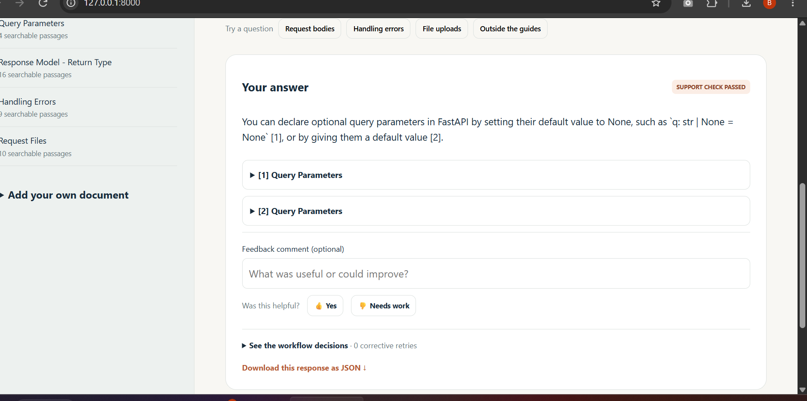

# Express Docs — technical documentation assistant

A local, self-corrective RAG assistant built for the Express Analytics AI/ML intern assignment. It answers questions from five official FastAPI guides, returns citations and a decision trace, retries weak retrieval within a fixed limit, and refuses unsupported answers. Python, LangGraph, FastAPI, Gemini and FAISS power the implementation; a small HTML/CSS/JavaScript interface provides the demo.

## Optional live test evidence

The candidate ran the app on Windows with their own Gemini key. Four useful questions returned cited answers with passed support checks, the weather question was refused, and feedback was saved. [Screenshots and original response downloads](evidence/live-user/README.md) record the demonstration. Earlier citation failures are retained separately as debugging evidence. [Validation details](VALIDATION.md) distinguish these live observations from automated tests.



## Run

Windows: read START_HERE.md and double-click START.cmd. A GUI saves the key privately in .env; installation and server startup follow. Keep the terminal open.

Linux/macOS, Python 3.12 recommended:

```bash
python -m venv .venv
source .venv/bin/activate
pip install -r requirements.txt
cp .env.example .env
# Edit .env and set GEMINI_API_KEY locally.
python -m uvicorn app.main:app --host 127.0.0.1 --port 8000
```

Open http://127.0.0.1:8000 and index the five guides. API documentation: http://127.0.0.1:8000/docs. Alternatively run `python scripts/ingest_corpus.py` while the server is running. Model operations require a valid key, internet access and provider quota; they may incur provider charges. No production fake-answer mode is present.

## Architecture and state

Ingestion cleans UTF-8 Markdown/text/HTML, splits it, calls Gemini document embeddings and commits document/chunk metadata plus vectors to SQLite. The in-memory FAISS index uses normalized vectors and exact inner-product search, equivalent to cosine similarity. It rebuilds from SQLite at startup.

LangGraph StateGraph executes:

- query_analysis: preserve the original question, produce a search rewrite and classify question type;
- retrieval: embed the search query, retrieve top-k chunks with document metadata;
- document_grading: ask the LLM to judge each retrieved chunk;
- conditional routing: useful chunks → generation; otherwise rewrite and retrieve again while retries remain; otherwise fallback;
- generation: answer using accepted chunks and explicit source labels;
- citation validation: reject missing, unknown or undeclared labels and omit known metadata IDs not cited inline; accept explicit S-labels in single/double brackets, and allow one regeneration to repair invalid citation formatting without inferring sources;
- optional grounding_check (enabled by default): judge factual support and source attribution; unsupported drafts become a refusal.

State carries question, search query, query type, retrieved/relevant chunks, retries, answer, sources, status, trace and fallback reason. Fresh state is created per request. MAX_RETRIES counts additional retrieval attempts, defaults to one, and is capped at three. An empty corpus takes a safe fallback without paid model calls. An LLM support check reduces risk; it cannot guarantee truth.

## Corpus and chunking

Five official guides: request bodies, query parameters, response models, error handling and request files. `corpus/manifest.json` records source URLs, timestamps and SHA-256 checksums. `scripts/fetch_corpus.py` refreshes the sources; `THIRD_PARTY_NOTICES.md` contains the FastAPI MIT notice. The confidential assignment PDF is deliberately absent from this repository.

Recursive character splitting uses 1,800 characters and 250 characters overlap, preferring paragraph/line boundaries. This balances focused retrieval with surrounding definitions/examples and affordable embedding sizes. It is a starting heuristic, not an experimentally optimal configuration. Long code blocks can be split; future evaluation should compare token-aware, code-aware or semantic chunking. Upload limit: 2 MiB and 150 chunks per document. Embedding batches contain 16 chunks. SHA-256 deduplication avoids repeat indexing. A failed embedding call does not commit a partial document; starter-corpus ingestion can retain earlier successfully indexed guides and safely retry.

## Environment

| Variable | Default / meaning |
|---|---|
| GEMINI_API_KEY | Required for model calls; never commit |
| GEMINI_MODEL | gemini-3.5-flash-lite; configurable for provider availability |
| EMBEDDING_MODEL | gemini-embedding-001 |
| EMBEDDING_DIMENSIONS | 768; supported settings 768/1536/3072 |
| TOP_K | 4; allowed 1–10 |
| MAX_RETRIES | 1; allowed 0–3 |
| CHECK_GROUNDING | true |
| DATA_DIR | data, relative to project unless absolute |

The store rejects a changed embedding model/dimension to prevent mixing incompatible vectors. For a new embedding configuration choose a new DATA_DIR and re-index. /health indicates whether a key exists, not whether the provider accepted it. requirements.txt specifies compatible ranges; requirements-tested.txt records the environment used for validation.

## API

| Endpoint | Input | Result |
|---|---|---|
| POST /query | JSON question (nonblank, ≤2,000 characters) | 200 answer/refusal, sources, trace, retries and query_id |
| POST /ingest | multipart file; optional source metadata | 201 new/duplicate document |
| GET /documents | none | 200 indexed documents |
| POST /feedback | query_id, rating up/down, optional comment | 201 saved; unknown query 404 |
| POST /ingest-corpus | none | 201 packaged guides |
| GET /health | none | 200 service/key-presence/model information |

Examples (server running; quotes shown for Bash):

```bash
curl http://127.0.0.1:8000/documents
curl -X POST http://127.0.0.1:8000/ingest -F 'file=@corpus/body.md'
curl -X POST http://127.0.0.1:8000/query -H 'Content-Type: application/json' -d '{"question":"How do I declare a JSON request body?"}'
# Replace QUERY_ID with the actual returned id:
curl -X POST http://127.0.0.1:8000/feedback -H 'Content-Type: application/json' -d '{"query_id":"QUERY_ID","rating":"up","comment":"Helpful explanation"}'
```

Response shape (illustrative, not a captured live model answer):

```json
{"query_id":"generated-id","answer":"Grounded answer with [1]","status":"answered","sources":[{"citation":1,"chunk_id":"chunk-id","document_id":"document-id","title":"Request Body","source":"https://fastapi.tiangolo.com/tutorial/body/","excerpt":"Retrieved passage"}],"retries":0,"query_type":"how-to","trace":[{"node":"query_analysis"}]}
```

Insufficient evidence returns status `insufficient_context`, no cited sources and an explanatory refusal. Invalid schemas return 422, invalid document content 400, oversized uploads 413, missing/changed starter files 409, and provider failures 503 with safe actionable messages. Feedback and queries persist in SQLite. API keys and raw SDK errors are not returned.

## Verification and tradeoffs

Run `python -m pytest -q` and, with Node installed, `node --test tests/frontend.test.cjs`. See VALIDATION.md and evidence/. Optional browser QA uses Playwright (`pip install playwright`, `python -m playwright install chromium`, then scripts/check_browser.py with the server running). CAPTURE_EVIDENCE.cmd records real local API responses after you configure a valid key and index guides.

This prototype intentionally uses a single local process and one worker. It has no authentication, distributed index coordination, web fallback, conversation memory or public deployment. File uploads satisfy the assignment's files-or-URLs choice; source URLs are metadata, not arbitrary server-side fetches. Keep it on loopback. Future work: labeled retrieval/answer evaluation, hybrid retrieval/reranking, batching relevance judgments, streaming, cancellation/timeouts, rate limits/authentication, prompt-injection evaluation and deployment hardening. Document text is treated as evidence, but adversarial content still deserves dedicated evaluation.

Read ASSIGNMENT_CHECKLIST.md for requirement mapping, GITHUB_SUBMISSION.md for delivery and UNDERSTAND_AND_INTERVIEW.md for the explanation. Developed with AI assistance; understand the code and represent that help honestly.

Official references: https://docs.langchain.com/oss/python/langgraph/agentic-rag · https://ai.google.dev/gemini-api/docs/models · https://ai.google.dev/gemini-api/docs/embeddings · https://ai.google.dev/gemini-api/docs/structured-output · https://fastapi.tiangolo.com/
